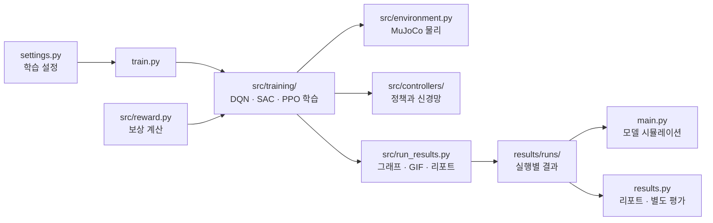

# 실습 가이드

## 설정과 튜닝

`settings.py`를 수정한 뒤 `train.py`를 다시 실행합니다. 실행마다 새 결과 폴더가 생깁니다.

| 수정할 값 | 의미 |
| --- | --- |
| `ALGORITHM` | `"dqn"`, `"sac"`, `"ppo"` 중 선택 |
| `EPISODES` | DQN 학습의 완료 에피소드 수 |
| `TOTAL_STEPS` | SAC/PPO 학습의 전체 환경 전이 수 |
| `NUM_ENVS` | 경험을 모으는 환경 수. `4`이면 환경 4개를 병렬 실행 |
| `WATCH` | 현재 정책을 별도 MuJoCo 창에서 보기 |
| `GIF_INTERVAL` | GIF를 저장할 완료 에피소드 간격 |
| `OPEN_REPORT` | 학습 시작 시 결과 리포트 자동 열기 |

학습률 등은 같은 파일의 `DQN`, `CONTINUOUS`에서 바꿉니다. 신경망 가중치는 학습으로 갱신됩니다.
보상 가중치와 오차 기준은 `src/reward.py`의 `STILL_WEIGHTS`, `STILL_*_SCALE`을 수정합니다.
같은 오차에서 가중치를 높이거나 기준값을 낮추면 비용이 커집니다.

| 관찰한 움직임 | 먼저 시도할 변경 |
| --- | --- |
| 중앙에서 멀리 멈춤 | `position` 가중치 증가 |
| 좌우 왕복이 계속됨 | `velocity` 가중치 증가 |
| 막대가 계속 흔들림 | `angular_velocity` 가중치 증가 |
| 힘이 급하게 바뀜 | `force_change` 가중치 증가 |

힘 필터의 `SMOOTHING_ALPHA` 또는 `MAX_FORCE_CHANGE`를 줄이면 변화가 제한됩니다.
회복도 느려질 수 있으므로 한 항목씩 바꾸고, 별도 평가에서 생존·정지율을 함께 비교하세요.
병렬 환경 수를 늘려도 항상 더 빠르거나 더 잘 학습되는 것은 아닙니다.

## 그래프와 GIF 읽기

보상 그래프의 회색은 학습 에피소드, 주황색은 최근 20회 평균, 파란색은 탐험을 끈 별도 평가입니다.
학습 보상은 탐험의 영향도 받습니다. 파란 평가 보상과 생존·정지율까지 함께 떨어지면
정책 성능이 나빠졌을 가능성이 있습니다. 오래 학습한다고 항상 좋아지지는 않습니다.

`best`는 학습 중 평가로 선택한 모델이고, `last`는 마지막 가중치입니다.
학습 중 GIF와 `WATCH` 창은 현재 정책의 독립 실행이며, 탐험 중인 학습 에피소드를 중계하지 않습니다.
GIF는 같은 초기 상태로 실행합니다. 종료 리포트에는 최고 모델 GIF와 마지막 현재 모델 GIF가 남습니다.

`main.py`와 `results.py`는 `ALGORITHM`의 최신 실행을 선택합니다.
이전 실행은 `--run results/runs/<폴더>`로 지정합니다. 마지막 모델은 `main.py --last` 또는
`results.py evaluate --last`, 화면 없는 실행은 `main.py --no-viewer`를 사용합니다.

별도 평가는 기본 100회, 초기 상태 시드 30000을 사용합니다. 정지율은 전체 시도 중
마지막 최대 2초 내내 위치 ±5cm, 속도 ±5cm/s, 각도 ±1도, 각속도 ±0.1rad/s를 만족하고
완주한 비율입니다. 오차 RMS는 완주한 실행의 마지막 최대 2초에서 계산합니다.
보상을 바꾼 실험끼리는 누적 보상만으로 순위를 정하지 마세요.

## 코드 구조



`src/config.py`는 물리 환경의 초기 범위·실패 경계, `src/cartpole.xml`은 MuJoCo 모델입니다.
`src/policy.py`가 저장한 모델을 불러오고, `src/evaluation.py`가 공통 지표를 계산합니다.
`src/rendering.py`는 GIF를, `src/training_preview.py`는 학습 중 별도 창을 담당합니다.

## 결과 폴더

```text
results/
├─ index.html, latest.json       실행 목록과 최신 실행 위치
└─ runs/<시각>_<알고리즘>/
   ├─ models/best.*, last.*      평가 선택 모델과 마지막 모델
   ├─ logs/                     학습·평가 CSV, 별도 평가 JSON
   ├─ plots/                    보상·평가 지표·움직임 PNG
   ├─ gifs/                     주기적으로 저장한 에피소드 GIF
   ├─ settings.json, best.json   실행 설정과 모델 선택 지표
   └─ index.html                그래프와 GIF를 보는 리포트
```

리포트는 학습 중 자동 갱신되며, 저장한 PNG와 GIF는 학습 후에도 볼 수 있습니다.
